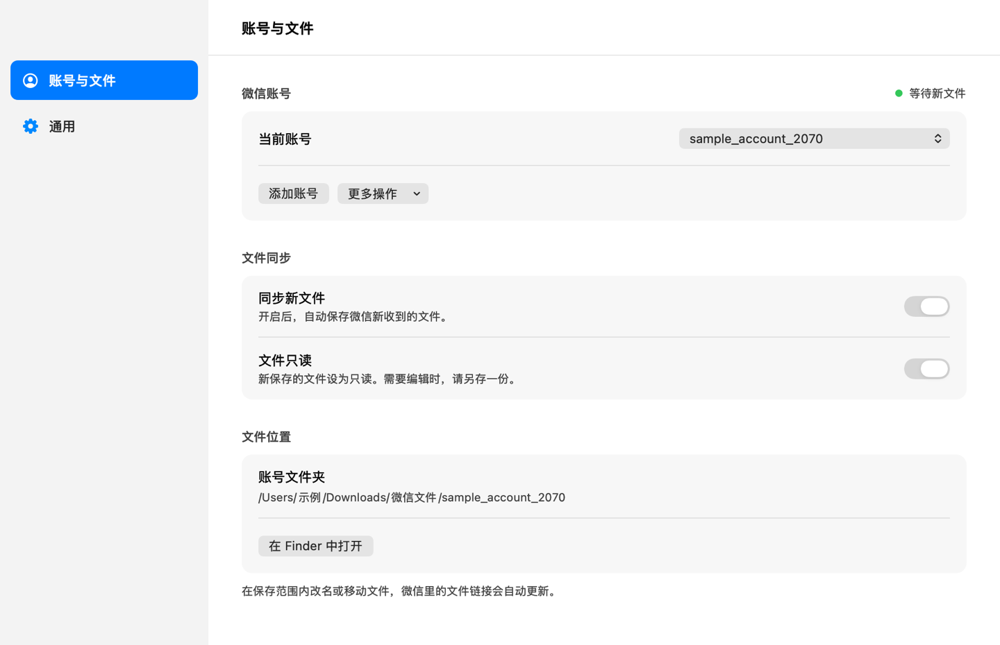

<p align="center">
  
</p>

# 微信文件同步

一款 macOS 菜单栏工具，把微信新接收到 Mac 的文件整理到你选定的文件夹。不同账号分开保存，同一账号的重复文件共用一份。在保存范围内改名或移动文件后，仍可从原来的微信聊天消息打开。

**[下载安装](https://github.com/CoderHanXin/wechat-file-sync-macos/releases)** · [使用指南](docs/user-guide.md) · [部署说明](docs/deployment.md)



## 下载安装

需要 macOS 13 或以上版本。通用安装包包含 Apple 芯片和 Intel 版本。

1. 到 [GitHub Releases](https://github.com/CoderHanXin/wechat-file-sync-macos/releases) 下载 `WeChatFileSync-v…-macOS.zip`，同页提供 SHA-256 校验文件。
2. 解压后运行 `Install.command`。应用会安装到 `~/Applications/WeChatFileSync.app` 并打开。

当前提供 ZIP 预发布测试包。应用使用 ad-hoc 本地签名，尚未经过 Apple 公证。从网页下载后，macOS 可能拦截首次启动。安装、升级和卸载细节见 [部署说明](docs/deployment.md)。

## 开始同步

1. 在「账号与文件」点击「允许访问微信文件夹…」，选择 `xwechat_files`。
2. 从列表选择要同步的账号，再选文件保存位置。
3. 点击「开始同步」。新文件会整理到 `保存位置/微信文件/账号目录/`。可以通过「添加账号」继续设置其他账号。

保存位置和微信文件夹需在同一文件系统上。关闭设置窗口后，应用继续在菜单栏同步。菜单栏的 W 图标可查看同步状态、打开保存位置或退出。

## 文件同步范围

- 同步范围限于首次启用之后接收到本机的文件附件。微信仍显示「接收文件」时，先在微信里接收。首次设置时已有的附件留在原处。
- 新保存的文件默认只读，可在设置中按账号调整。需要编辑时，可以另存一份。
- 在选定的保存范围内整理文件，微信里的链接会随文件位置更新。删除保存的文件后，对应的聊天入口可能无法打开。找回原文件或副本时，可按 [文件关联恢复说明](docs/user-guide.md#删除与两条恢复路径) 操作。

## 从源码构建

使用 macOS 的 Xcode Command Line Tools 即可构建。

```sh
bash build.sh 0.6.10-test
```

构建结果位于 `dist/`。 [构建和部署](docs/deployment.md) · [更新记录](CHANGELOG.md) · [验收记录](docs/validation-report.md) · [开发文档](docs/README.md)

## 项目来源与致谢

本项目 fork 自 [Whaoo0/wechat-download-sync-macos](https://github.com/Whaoo0/wechat-download-sync-macos)。整理微信接收文件、通过链接保留微信原有打开入口的思路，以及部分代码，来自上游项目。在此基础上，本项目加入了多账号管理、内容去重和 macOS 菜单栏设置界面。

感谢原作者的开源工作。本仓库保留原作者的版权声明和 [MIT 许可证](LICENSE)。本项目与腾讯微信没有官方关联。
